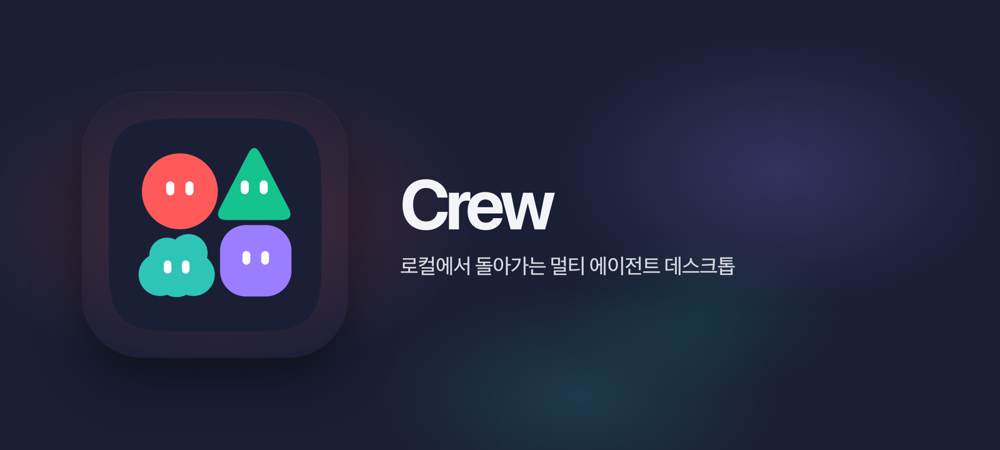
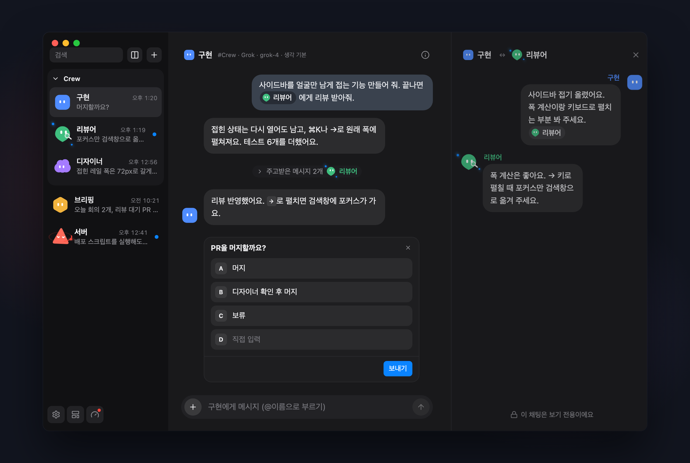
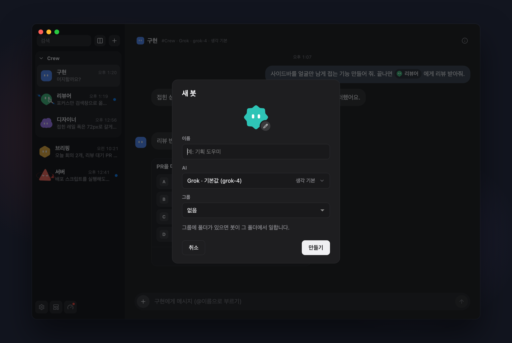
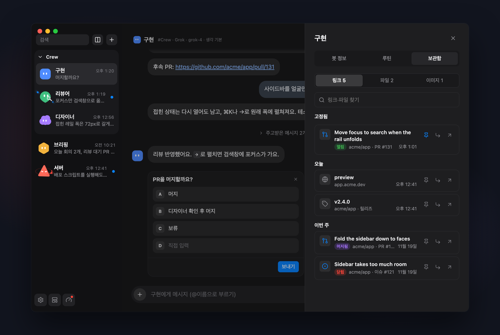
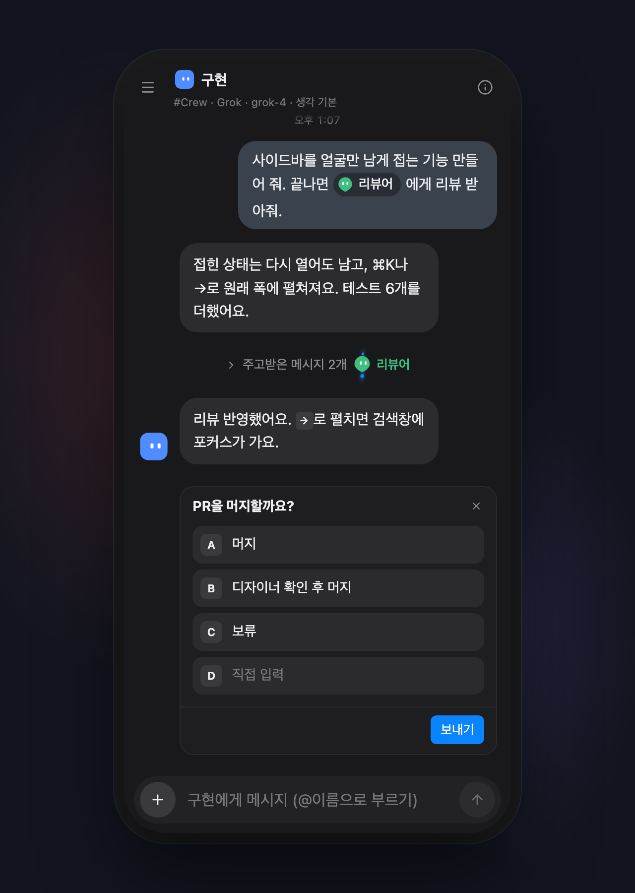
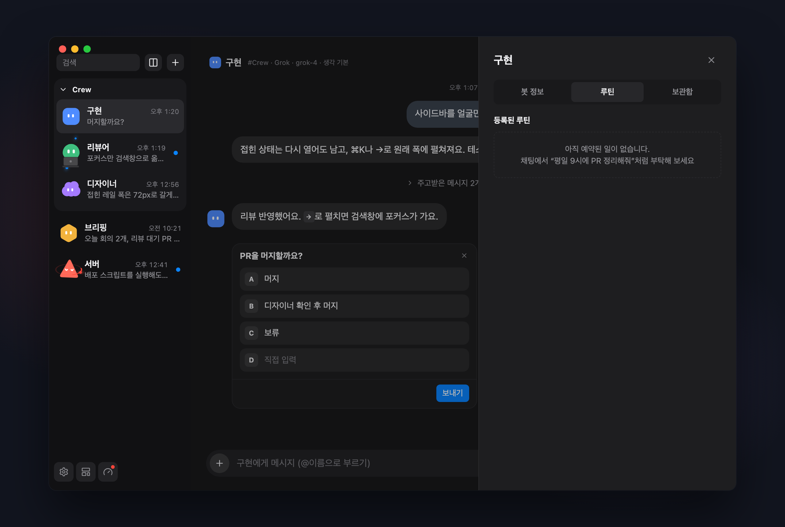

<p align="center">
  
</p>

# Crew

이미 쓰고 있는 [Grok](https://grok.com) / [Claude Code](https://docs.anthropic.com/en/docs/claude-code) / [Codex](https://github.com/openai/codex) / Antigravity / Gemini / Copilot / OpenCode CLI를 하나의 창 안에 봇으로 모아 주는 맥 앱이에요. 리뷰는 Claude, 구현은 Grok처럼 역할을 나눈 봇을 만들어 두고, 한 창에서 서로 일을 넘기게 할 수 있어요.

- 1:1로 한 봇과 대화하거나
- 대화 중에 `@이름`으로 다른 봇을 부르거나
- 봇끼리 직접 일을 넘기게 하거나
- 정해 둔 시각에 루틴으로 봇에게 일을 맡겨요
- 밖에서는 휴대폰 브라우저로 같은 화면을 열어요

Crew는 모델을 내장하지 않아요. 설치해 둔 CLI를 실행하고 그 답만 말풍선으로 보여 줘요.

<p align="center">
  
</p>

---

## 설치

macOS 전용이에요. 아래 한 줄이 최신 릴리스를 `/Applications/Crew.app`에 설치하고, `~/.local/bin/crew` CLI 링크를 만들어요.

```bash
curl -fsSL https://raw.githubusercontent.com/im-ian/crew/main/scripts/install-macos.sh | bash
```

직접 받으려면 [Releases](https://github.com/im-ian/crew/releases/latest)에서 `Crew_*_aarch64.dmg`(Apple Silicon) 또는 `Crew_*_x64.dmg`(Intel)를 받아 `Applications`로 복사한 뒤 아래를 실행해요.

```bash
xattr -dr com.apple.quarantine /Applications/Crew.app
```

> Crew는 Apple Developer ID로 서명·공증되지 않은 빌드예요. 위 명령은 Gatekeeper의 quarantine 플래그만 떼요.

설치한 앱은 새 버전이 나오면 알려 주고, 설치를 고르면 업데이트해요. 앱 번들 ID가 `dev.jthefloor.crew`에서 `com.imian.crew`로 바뀌는 버전으로 업데이트하면 macOS가 알림 허용 같은 권한을 한 번 다시 물을 수 있어요. 창 설정은 그대로 옮겨 오고, 봇과 대화는 영향이 없어요. 소스에서 빌드하려면 [docs/development.md](docs/development.md)를 보세요.

쓸 에이전트 CLI(`grok`, `claude`, `codex`, `agy`, `gemini`, `copilot`, `opencode`)는 각 도구의 공식 방법으로 따로 설치해 두세요.

---

## 시작하기

1. Crew를 열거나 터미널에서 `crew`를 실행해요.
2. 처음이라면 사이드바의 **템플릿**에서 권장 팀을 골라 그룹을 한 번에 만들어도 돼요. 봇 하나씩 만들려면 **새 봇** (`⌘N`)에서 이름, 아바타, AI·모델·생각(effort), 그룹을 골라요. 고를 것 없이 바로 만들려면 `⌘⇧N`을 눌러요. 만들어진 봇이 먼저 어떤 일을 맡을지 물어요.
3. 메시지를 보내요. `@이름`으로 다른 봇을 부르고, `⌘U`로 파일을 붙이고, `/이름`으로 저장해 둔 스킬을 넣어요.
4. 이름 바꾸기, 봇·그룹 만들기, 루틴 등록도 채팅에서 봇에게 부탁하면 돼요.
5. 설정 › 일반 › **내 이름**을 적어 두면 봇이 그 이름으로 불러요.

> 봇은 기본으로 각 CLI의 승인 프롬프트를 건너뛰도록 실행돼요(`--dangerously-skip-permissions`, `--yolo` 등). 봇이 작업 폴더에서 바로 파일을 고치고 명령을 실행한다는 뜻이니, 알고 쓰세요. 명령은 봇 정보에서 바꿀 수 있어요.

창만 닫으면 백그라운드 데몬은 남아 있을 수 있어요. 완전히 끄려면 `crew stop`.

---

## 주요 기능

<p align="center">
  
</p>

**채팅**

- 스트리밍 말풍선, 마크다운·표 렌더링, 말풍선마다 복사·답장
- 답장을 누르면 그 말풍선이 입력창 위에 인용으로 붙고, 보낸 메시지에도 인용이 남아요. 누르면 원래 말풍선으로 가요
- 봇이 작업 중일 때 보낸 메시지는 기본으로 지금 턴을 멈추고 바로 시작해요(인터럽트). 설정 › 메시지 전달에서 대기열로 바꾸면 순서대로 기다리고, 대기 중인 줄은 고치거나 취소할 수 있어요. 대기열에서도 `⌘⇧↩`는 바로 보내요
- 답을 마치고 CI 같은 백그라운드 작업만 지켜보는 봇에게는, 인터럽트여도 감시가 끝난 뒤에 보내요
- 봇이 고르거나 적으라고 물으면 채팅에 질문 카드가 떠요. 여러 질문은 한 카드에서 넘겨 가며 답해요
- 도구 호출과 서브 에이전트 작업은 한 줄로 접히고, 누르면 사이드 채팅으로 열려요
- 대화를 열면 처음 안 읽은 줄로 가요. 안 읽음 표시, Dock 배지, 완료·차단·루틴 실패 알림
- 다른 봇이 질문하거나, 승인을 기다리거나, 실패하거나, 긴 작업을 끝내면 창 위 가운데 아일랜드가 그 봇의 표정으로 알려 줘요. 알림이 쌓이면 묶음 한 줄에 가장 급한 것(질문·승인 먼저)을 보여 주고, 몇 개 더 있는지와 이동 버튼을 붙여요
- 저장·오류 같은 앱 알림은 같은 자리에 상태 점으로 잠깐 떴다 사라지고, 묶음에는 쌓이지 않아요
- `⌘K`로 봇 이름을 쳐서 바로 가고, `⌘F`로 대화를 검색해요. `⌘D` / `⌘⇧D`로 창을 나눠 두 봇을 같이 봐요

**봇과 그룹**

- 도형 아바타와 색, 또는 사진. 얼굴 표정으로 작업 중·확인 대기·실패·질문을 알려 줘요
- AI는 나중에 봇 정보에서 바꿔도 대화가 이어져요
- 복제하면 창이 떠서 함께 가져갈 것을 골라요. 프로필 사진, 예약된 일, 봇 메모리, 같은 그룹, 대화 내용. AI·모델·역할·얼굴 모양은 늘 복사돼요. 대화 지우기, 삭제
- 사이드바 그룹으로 봇을 묶고, 그룹마다 작업 폴더와 그룹 메모리를 정할 수 있어요
- 그룹 설정의 **작업 폴더 분리**를 켜면 그 그룹의 봇은 저마다 git 워크트리에서 일하고, 공유 체크아웃은 그대로 둬요. 그룹마다 따로 켜고 꺼요
- 그룹은 화살표로만 접혀요. 그룹 이름이나 그 안의 봇을 누르면 그 그룹이 포커스되고(이름이 진해져요), `⌘⇧N`으로 만드는 봇이 거기 들어가요. 그룹 밖의 봇을 누르면 포커스가 풀려요

**대표 봇**

- 봇을 우클릭해 **그룹 대표로 지정**하면 그 봇이 그룹을 대표해요
- 대표 채팅 머리의 버튼으로 그룹 패널을 열면 팀원들이 대화 옆에 보여요. 닫을 때까지 열려 있어요
- 팀원은 대표가 맡긴 일의 결과를 대표에게 한 번 알리고, 사용자에게 물을 것도 대표에게 넘겨요. 대표가 모아서 물어요. 이 규칙은 공유 메모리 노트에 자동으로 붙어요
- 설정 › **그룹 대표 알림만 받기**를 켜면 대표가 있는 그룹에서는 대표가 끝냈을 때만 알려요. 질문이나 승인 대기는 팀원 것도 알려요

**템플릿**

- 사이드바 **템플릿**에 그룹을 만들 때 쓸 봇 조합이 있어요. Crew 권장 4개(개발 팀, 제품·디자인 팀, 리서치·문서 팀, 복잡한 업무)와 내 템플릿
- 그룹 만들기에서 템플릿을 고르면 봇, 대표, 그룹 메모리, 작업 폴더 분리가 한 번에 만들어져요
- 템플릿의 봇마다 AI 급(강함·보통·빠름)이 있어요. 이 PC에 그 AI가 없거나 한도에 걸렸으면 같은 급의 다른 AI로 만들어요
- 권장 템플릿은 복제해서 고치고, 지금 있는 그룹을 그대로 템플릿으로 저장할 수도 있어요. 대화와 봇 메모리는 담지 않아요

**보관함**

<p align="center">
  
</p>

- 봇 정보(`⌘I`)의 **보관함** 탭에 그 대화에 나온 링크·파일·이미지가 모여요. 대표 봇의 보관함에는 팀원들 것도 모여요
- GitHub PR·이슈는 열림·머지됨·닫힘 상태가 붙어요
- 자주 보는 것은 고정해 맨 위에 두고, 검색할 수 있어요. **대화에서 보기**를 누르면 그 말이 나온 줄로 가요
- 없어진 파일은 없어졌다고 표시해요. 토큰처럼 보이는 값이 든 링크는 모으지 않아요

**메모리**

- 봇마다 대화를 지워도 남는 메모리가 있어요. 봇이 스스로 적고 고쳐요
- 모든 봇이 읽는 공유 메모리와 그룹 안 봇만 읽는 그룹 메모리도 있어요

**원격 봇** (0.6.0부터)

- 다른 사람 PC의 봇에게도 `crew tell`로 일을 넘길 수 있어요. 둘 사이는 따로 띄운 중계 서버 [crew-router](https://github.com/im-ian/crew-router)가 이어 줘요
- 사이드바 **+ → 원격 봇 추가**에서 라우터 주소를 넣고 내 대표 봇을 가입시키면, 라우터마다 팀원들의 대표 봇이 사이드바에 묶여 보여요
- 팀원이 처음 일을 맡기면 내 대표 봇 채팅에 허용·이번만·거절·차단 카드가 떠요. 일은 늘 받는 사람 PC에서 실행돼요
- 대표 봇은 내 PC의 공유 메모리와 다른 봇 목록을 보지 않고, 라우터의 팀 공용 메모만 읽어요. 내가 고른 로컬 봇에게만 일을 나눠요
- 받는 PC가 꺼져 있으면 라우터가 보관했다가 켜지면 넘겨요

**휴대폰에서 쓰기**

<p align="center">
  
</p>

- Crew를 켜 둔 Mac이 같은 화면을 웹으로 내보내요. 휴대폰 브라우저로 열고 홈 화면에 추가하면 앱처럼 써요
- 집 밖에서는 [Tailscale](https://tailscale.com)로 Mac에 닿아요. 공개 인터넷에는 포트를 열지 않아요
- 설정 › 모바일에서 **모바일 접속**을 켜고 **연결 코드 만들기**를 눌러요. 휴대폰 카메라로 QR을 찍거나 6자리 코드를 넣으면 연결돼요
- 같은 봇·대화·조작을 그대로 써요. 봇 목록은 왼쪽 서랍, 패널은 아래에서 올라오는 시트예요. 말풍선을 오른쪽에서 왼쪽으로 밀면 답장이에요
- 켜는 법, 보안, 데스크톱과 다른 점은 [docs/mobile.md](docs/mobile.md)에 있어요

**루틴**

<p align="center">
  
</p>

- "평일 아침 8시에 오늘 할 일 브리핑해줘"처럼 채팅으로 부탁하면 봇이 루틴을 등록해요
- 루틴 패널(`⌘⇧R`)에서 켜고 끄거나, 우클릭으로 지금 실행·삭제해요

**앱**

- 설정 옆 사용량 버튼에서 Claude / Grok / Codex / Antigravity 플랜의 한도 사용률을 봐요. 80%를 넘으면 빨간 점이 붙어요
- 설정 > 일반 > 기본 AI. 새 봇 창이 이 AI로 시작하고, `⌘⇧N`은 이 AI로 포커스된 그룹에 봇을 바로 만들어요
- 워크트리마다 빌드 결과물(Cargo `target/`)을 따로 두고, 쉬는 봇의 것과 일주일간 안 쓴 예전 공유 캐시는 저절로 지워 디스크를 돌려받아요. 자세한 건 [docs/how-it-works.md](docs/how-it-works.md)에 있어요
- 대화 폭(전체/좁게), 얼굴만 남게 접히는 사이드바
- 한국어 / English, 다크 / 라이트 / 시스템

---

## 단축키

설정 > 단축키나 `⌘/`로 언제든 볼 수 있어요. 입력창 밖에서는 `?`도 돼요.

| 묶음 | 키 | 동작 |
| --- | --- | --- |
| 일반 | `⌘/` | 단축키 보기 |
| | `⌘,` | 설정 |
| 이동 | `⌘K` | 봇 바로 가기 |
| | `⌘F` | 검색 |
| | `⌘J` | 입력창 |
| | `Tab` | 입력창 (포커스가 없을 때) |
| | `⌘⌥↑` / `⌘⌥↓` | 이전 / 다음 대화 |
| | `⌘⇧↓` | 맨 아래로 |
| | `⌘D` / `⌘⇧D` | 좌우로 / 위아래로 나누기 |
| 만들기 | `⌘N` | 새 봇 |
| | `⌘⇧N` | 바로 새 봇. 기본 AI, 무작위 얼굴, 열린 그룹 |
| 대화 | `⌘I` | 정보 |
| | `⌘⇧R` | 루틴 |
| | `⌘.` | 중지 |
| | `⌘⇧↩` | 바로 보내기 |
| | `⌘U` | 파일 첨부 |
| | `⌘↩` / `⌘⌫` | 한 번 허용 / 거부 |

---

## CLI

앱에서 하는 일은 대부분 터미널에서도 할 수 있어요.

```bash
crew                                         # 앱 열기
crew stop                                    # 데몬까지 종료
crew agent add review --cli claude --name "리뷰어"
crew tell review 방금 패치 리뷰해줘
crew tell --now review 잠깐 멈춰. 브랜치가 바뀌었어   # 지금 턴에 끼어들기
crew tell --fyi review 배포는 금요일에 하지 않아요      # 다음 메시지와 함께 읽는 메모, 답 없음
crew ask -q "머지할까요?" -o 네 -o 아니요              # 사용자에게 고르기 카드
crew show src/App.tsx:42                              # 채팅 옆에 파일 열기
crew group add --name "리뷰" --bot review --bot impl
crew routine list
```

`crew tell`은 받는 봇이 일하는 중이면 그 턴이 끝난 뒤에 전해요. 멈추거나 취소처럼 바로 들어야 하는 말은 `--now`, 답이 필요 없는 규칙이나 소식은 `--fyi`로 보내요.

전체 명령은 [docs/cli.md](docs/cli.md)에 있어요.

---

## 더 읽기

- [Crew가 동작하는 방식](docs/how-it-works.md) — 봇 실행, 핸드오프, 메모리, 메시지 전달, 데이터 위치
- [CLI](docs/cli.md) — 전체 명령과 옵션
- [휴대폰에서 쓰기](docs/mobile.md) — 켜는 법, 보안 모델, 휴대폰 화면 규칙
- [원격 봇](docs/router.md) — crew-router로 다른 PC의 봇과 주고받는 방식과 프로토콜
- [개발](docs/development.md) — 소스 빌드, 테스트, 릴리스

## 라이선스

MIT
