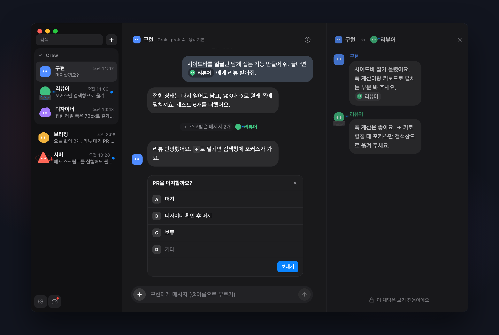
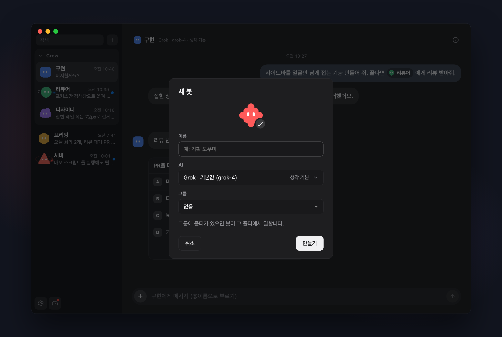
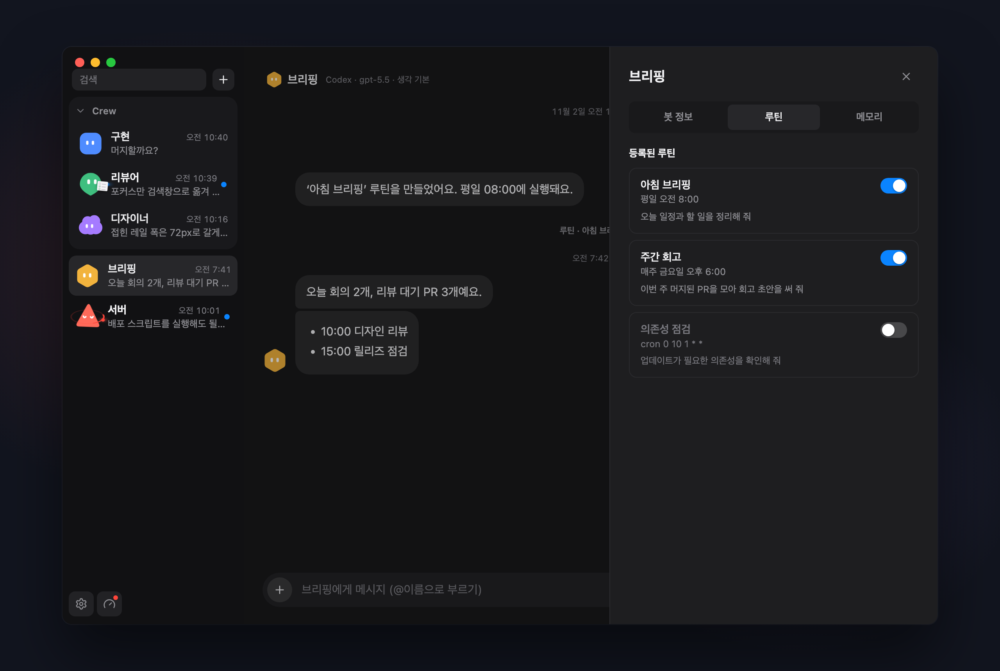

<p align="center">
  
</p>

# Crew

이미 쓰고 있는 [Grok](https://grok.com) / [Claude Code](https://docs.anthropic.com/en/docs/claude-code) / [Codex](https://github.com/openai/codex) / Antigravity / Gemini / Copilot / OpenCode CLI를 하나의 창 안에 봇으로 모아 주는 맥 앱이에요. 리뷰는 Claude, 구현은 Grok처럼 역할을 나눈 봇을 만들어 두고, 한 창에서 서로 일을 넘기게 할 수 있어요.

- 1:1로 한 봇과 대화하거나
- 대화 중에 `@이름`으로 다른 봇을 부르거나
- 봇끼리 직접 일을 넘기게 하거나
- 정해 둔 시각에 루틴으로 봇에게 일을 맡겨요

Crew는 모델을 내장하지 않아요. 설치해 둔 CLI를 실행하고 그 답만 말풍선으로 보여 줘요.

<p align="center">
  
</p>

---

## 설치

macOS 전용이에요. 아래 한 줄이 최신 릴리스를 `/Applications/Crew.app`에 설치하고, `~/.local/bin/crew` CLI 링크를 만들어요.

```bash
curl -fsSL https://raw.githubusercontent.com/im-ian/crew/main/scripts/install-macos.sh | bash
```

직접 받으려면 [Releases](https://github.com/im-ian/crew/releases/latest)에서 `Crew_*_aarch64.dmg`(Apple Silicon) 또는 `Crew_*_x64.dmg`(Intel)를 받아 `Applications`로 복사한 뒤 아래를 실행해요.

```bash
xattr -dr com.apple.quarantine /Applications/Crew.app
```

> Crew는 Apple Developer ID로 서명·공증되지 않은 빌드예요. 위 명령은 Gatekeeper의 quarantine 플래그만 떼요.

설치한 앱은 새 버전이 나오면 알려 주고, 설치를 고르면 업데이트해요. 소스에서 빌드하려면 [docs/development.md](docs/development.md)를 보세요.

쓸 에이전트 CLI(`grok`, `claude`, `codex`, `agy`, `gemini`, `copilot`, `opencode`)는 각 도구의 공식 방법으로 따로 설치해 두세요.

---

## 시작하기

1. Crew를 열거나 터미널에서 `crew`를 실행해요.
2. **새 봇** (`⌘N`)에서 이름, 아바타, AI·모델·생각(effort), 그룹을 골라요. 고를 것 없이 바로 만들려면 `⌘⇧N`을 눌러요. 만들어진 봇이 먼저 어떤 일을 맡을지 물어요.
3. 메시지를 보내요. `@이름`으로 다른 봇을 부르고, `⌘U`로 파일을 붙이고, `/이름`으로 저장해 둔 스킬을 넣어요.
4. 이름 바꾸기, 봇·그룹 만들기, 루틴 등록도 채팅에서 봇에게 부탁하면 돼요.

> 봇은 기본으로 각 CLI의 승인 프롬프트를 건너뛰도록 실행돼요(`--dangerously-skip-permissions`, `--yolo` 등). 봇이 작업 폴더에서 바로 파일을 고치고 명령을 실행한다는 뜻이니, 알고 쓰세요. 명령은 봇 정보에서 바꿀 수 있어요.

창만 닫으면 백그라운드 데몬은 남아 있을 수 있어요. 완전히 끄려면 `crew stop`.

---

## 주요 기능

<p align="center">
  
</p>

**채팅**

- 스트리밍 말풍선, 마크다운·표 렌더링, 말풍선마다 복사·답장
- 봇이 작업 중일 때 보낸 메시지는 기본으로 지금 턴을 멈추고 바로 시작해요. 설정에서 대기열로 바꾸면 순서대로 기다리고, 대기 중인 줄은 고치거나 취소할 수 있어요
- 봇이 고르거나 적으라고 물으면 채팅에 질문 카드가 떠요. 여러 질문은 한 카드에서 넘겨 가며 답해요
- 도구 호출과 서브 에이전트 작업은 한 줄로 접히고, 누르면 사이드 채팅으로 열려요
- 대화를 열면 처음 안 읽은 줄로 가요. 안 읽음 표시, Dock 배지, 완료·차단·루틴 실패 알림

**봇과 그룹**

- 도형 아바타와 색, 또는 사진. 얼굴 표정으로 작업 중·확인 대기·실패·질문을 알려 줘요
- AI는 나중에 봇 정보에서 바꿔도 대화가 이어져요
- 복제, 대화 지우기, 삭제
- 사이드바 그룹으로 봇을 묶고, 그룹마다 작업 폴더와 그룹 메모리를 정할 수 있어요

**메모리**

- 봇마다 대화를 지워도 남는 메모리가 있어요. 메모리 탭에서 적거나, 봇이 스스로 적어요
- 모든 봇이 읽는 공유 메모리와 그룹 안 봇만 읽는 그룹 메모리도 있어요

**루틴**

<p align="center">
  
</p>

- "평일 아침 8시에 오늘 할 일 브리핑해줘"처럼 채팅으로 부탁하면 봇이 루틴을 등록해요
- 루틴 패널(`⌘⇧R`)에서 켜고 끄거나, 우클릭으로 지금 실행·삭제해요

**앱**

- 설정 옆 사용량 버튼에서 Claude / Grok / Codex / Antigravity 플랜의 한도 사용률을 봐요. 80%를 넘으면 빨간 점이 붙어요
- 설정 > 일반 > 기본 AI. 새 봇 창이 이 AI로 시작하고, `⌘⇧N`은 이 AI로 지금 열린 봇의 그룹에 봇을 바로 만들어요
- 대화 폭(전체/좁게), 얼굴만 남게 접히는 사이드바
- 한국어 / English, 다크 / 라이트 / 시스템

---

## 단축키

설정 > 단축키나 `⌘/`로 언제든 볼 수 있어요. 입력창 밖에서는 `?`도 돼요.

| 묶음 | 키 | 동작 |
| --- | --- | --- |
| 일반 | `⌘/` | 단축키 |
| | `⌘,` | 설정 |
| 이동 | `⌘K` | 검색 |
| | `⌘J` | 입력창 |
| | `⌘⌥↑` / `⌘⌥↓` | 이전 / 다음 대화 |
| | `⌘⇧↓` | 맨 아래 |
| 만들기 | `⌘N` | 새 봇 창 열기 |
| | `⌘⇧N` | 창 없이 바로 새 봇. 기본 AI, 무작위 얼굴, 지금 열린 봇의 그룹 |
| 대화 | `⌘I` | 봇 정보 |
| | `⌘⇧R` | 루틴 |
| | `⌘.` | 중지 |
| | `⌘⇧↩` | 바로 보내기 |
| | `⌘U` | 파일 첨부 |
| | `⌘↩` / `⌘⌫` | 한 번 허용 / 거부 |

--- | --- |
| `⌘K` | 검색 |
| `⌘N` | 새 봇 |
| `⌘⇧N` | 기본 AI와 무작위 얼굴로 바로 새 봇 |
| `⌘I` | 봇 정보 |
| `⌘⇧R` | 루틴 |
| `⌘,` | 설정 |
| `⌘J` | 입력창 |
| `⌘⌥↑` / `⌘⌥↓` | 이전 / 다음 대화 |
| `⌘⇧↓` | 맨 아래 |
| `⌘U` | 파일 첨부 |
| `⌘.` | 중지 |
| `⌘⇧↩` | 바로 보내기 |
| `⌘↩` / `⌘⌫` | 한 번 허용 / 거부 |

---

## CLI

앱에서 하는 일은 대부분 터미널에서도 할 수 있어요.

```bash
crew                                         # 앱 열기
crew stop                                    # 데몬까지 종료
crew agent add review --cli claude --name "리뷰어"
crew tell review 방금 패치 리뷰해줘
crew routine list
```

전체 명령은 [docs/cli.md](docs/cli.md)에 있어요.

---

## 더 읽기

- [Crew가 동작하는 방식](docs/how-it-works.md) — 봇 실행, 핸드오프, 메모리, 메시지 전달, 데이터 위치
- [CLI](docs/cli.md) — 전체 명령과 옵션
- [개발](docs/development.md) — 소스 빌드, 테스트, 릴리스

## 라이선스

MIT
